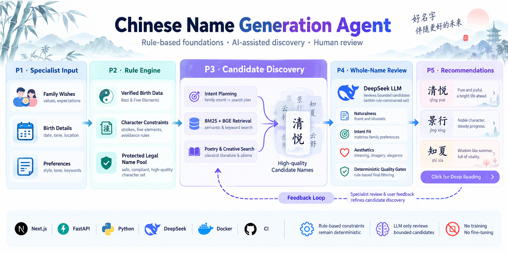
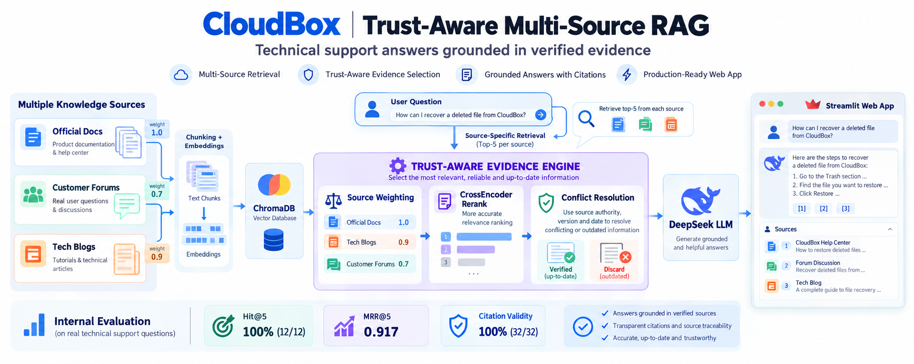
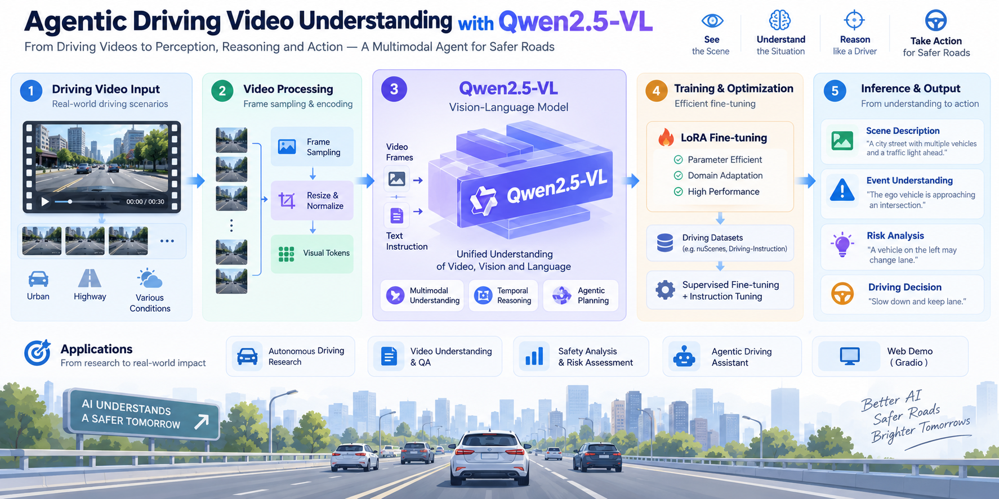
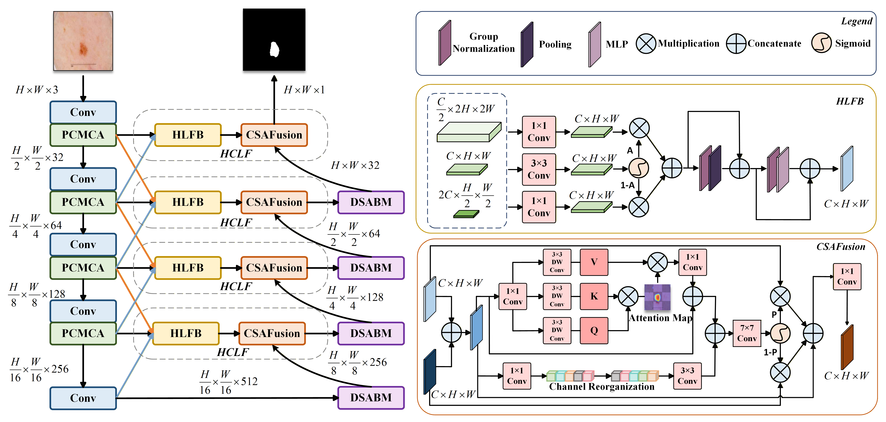

# Hi, I'm Yushen Ding 👋

M.S. student in Electrical and Computer Engineering (Machine Learning & Data Science) at the University of Southern California (USC).

Interested in AI Engineering, Software Engineering, and Machine Learning, with hands-on experience in LLM Agents, RAG Systems, Computer Vision, and Deep Learning.

Passionate about building reliable, scalable AI applications, combining machine learning research with practical software engineering.

## 🔥 Featured Projects

### [Chinese Name Generator — AI-Assisted Legacy Modernization](https://github.com/ethandingsc/Chinese-Name-Generator-AI-Assisted-Legacy-Modernization) · *Aug 2026 – Oct 2026*

  

- Modernized a legacy employee-facing naming system into a **Next.js, TypeScript, and FastAPI** application while preserving deterministic birth-data, Five-Element, stroke-count, character, and taboo constraints.
- Built an **agentic recommendation workflow** combining BM25 and vector retrieval, classical-poetry RAG, constrained candidate exploration, and LLM-based whole-name evaluation with diversity control and user-feedback refinement.
- Added **evidence-grounded explanations** that verify poetry quotations and cultural sources, separating factual references from creative interpretation to reduce unsupported AI claims.
- Productionized the system with **126 Golden Tests, 178+ automated tests, GitHub Actions CI, and Docker Compose** deployment with persistent workflow state and retrieval caches.

### [CloudBox — Multi-Source RAG for Technical Support](https://github.com/ethandingsc/cloudbox-multi-source-rag) · *Sep 2026 – Oct 2026*

  

- Built a **multi-source technical-support RAG system** integrating official documentation, customer forums, and technical blogs with source-specific chunking and **ChromaDB** vector retrieval.
- Combined **source-authority weighting, CrossEncoder reranking, and version-aware conflict resolution** to select reliable evidence and generate grounded answers with traceable chunk citations.
- Achieved **95.00% Hit@5 and 93.54% Recall@5** at the final evidence-selection stage on a fixed **120-query synthetic evaluation set**, with reproducible retrieval experiments.
- Delivered **FastAPI endpoints, Kafka-backed asynchronous workers, and Redis caching and session history**, packaged with **Docker Compose** and GitHub Actions CI running offline regression tests.

### [Agentic Driving Video Understanding with Qwen2.5-VL](https://github.com/ethandingsc/Agentic-Driving-Video-Understanding-with-Qwen2.5-VL) · *Sep 2026*

  

* Fine-tuned **Qwen2.5-VL-7B with LoRA** for multi-frame driving-video understanding, improving **MCQ Accuracy from 76.40% to 81.62%** and **Lingo-Judge from 61.71% to 73.74%**
* Evaluated **Uniform / Dense / Event-aware temporal sampling** and found that dense sampling can lose long-range temporal context despite capturing more local motion
* Built a **LangGraph agent** that uses Qwen2.5-VL as a planner to select safety-critical temporal segments, then performs **local re-sampling and detailed multimodal analysis**
* Integrated lightweight **RAG** for driving-safety knowledge grounding and deployed the fine-tuned model with **SGLang + Gradio**

### [GSMBNet — Medical Image Segmentation](https://github.com/ethandingsc/GSMBNet) · *Jun 2025 – Dec 2025*

  

- Designed a cross-scale morphology and boundary modeling network for medical image segmentation
- Conducted **80+ comparative and ablation experiments**
- Achieved **2%+ improvement in mIoU and mDSC** over U-Net baselines on ISIC2017/2018

## 💼 Experience

### Traffic Control Technology Co., Ltd. — Deep Learning Data Intern
**Railway Autonomous Driving | Jul 2025 – Aug 2025**

- Supported computer vision dataset development for **railway autonomous driving**, focusing on data quality analysis, annotation standards, and hard-example mining.
- Developed a **lightweight-model-assisted auto-labeling and human review workflow** to streamline dataset annotation and quality control.
- Analyzed challenging scenarios, including **adverse weather, low-light environments, curved tracks, and small-object detection**, to identify dataset limitations and model failure cases.

### Beijing Limingtang Culture Technology Co., Ltd. — AI Development Intern
**Speech Synthesis & AI Applications | Jun 2024 – Aug 2024**

- Built and processed speech-cloning datasets using **GPT-SoVITS**, including audio denoising, segmentation, and normalization.
- Improved training data diversity through dialect and noisy-environment samples, and optimized training configurations for voice-cloning quality.

## 🛠️ Technical Skills

**Languages:** Python · C++ · TypeScript

**AI / Machine Learning:** PyTorch · Transformers · CNNs · LoRA · Vision-Language Models · Computer Vision

**LLM & Agent Engineering:** LLM Agents · RAG · BM25 · Hybrid Retrieval · Prompt Engineering · Agent Workflows

**Software Engineering:** REST APIs · Async Programming · Concurrency Control · Git · Linux

**Frameworks & Tools:** OpenCV · Gradio · SGLang · Claude Code · Gemini API

## 📄 Publications

- **GSMBNet: A Cross-Scale Morpho-Boundary Modeling Network for Medical Image Segmentation** — ICIC 2026, Springer LNCS
- **Enhanced YOLO Optimization Study for Road Sign Detection in Autonomous Driving** — CVIDL 2024, IEEE

## 📫 Contact

📧 [yushending1014@gmail.com](mailto:yushending1014@gmail.com)

